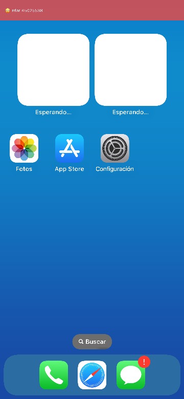
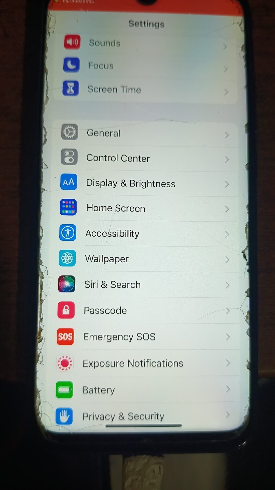
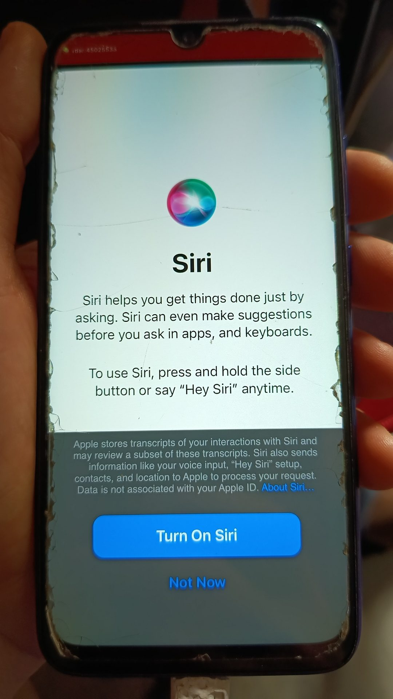
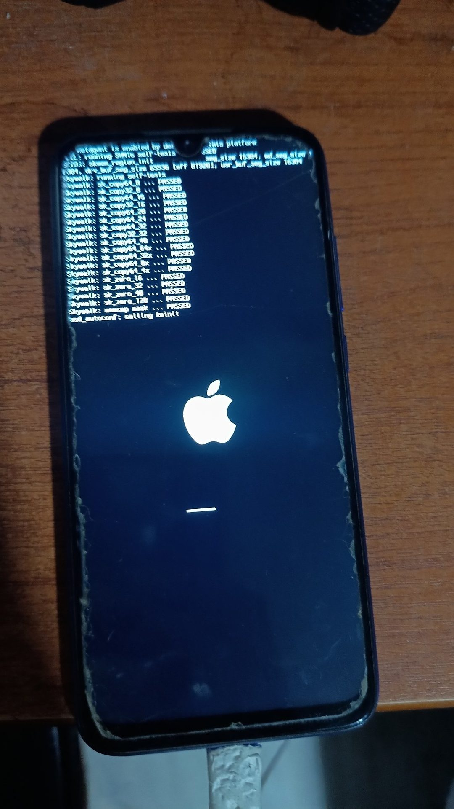

# iOS 16 en el Redmi Note 7 (lavender)

Port de investigación, no comercial, de **XNU 8796** (Darwin 22 / iOS 16) y del userland de **iPhone X (D22AP) iOS 16.7.16** al **Redmi Note 7** (`lavender`, Qualcomm SDM660 / Snapdragon 660).



> **Estado: arranca hasta el lock screen y la pantalla de inicio de iOS 16.7.16 en ~2–3 minutos.** Es un bring-up experimental, no un teléfono de uso diario. En la pantalla de inicio se dibujan los íconos, el dock y las notificaciones, Ajustes abre y aparece la pantalla inicial de Siri; funcionan el touch (taps y swipes), los botones físicos, la red USB (CDC-NCM: ping, SSH y log del kernel en vivo desde Windows) y las lecturas rápidas de eMMC (ADMA2). No funcionan la GPU, Wi-Fi, Bluetooth, audio, cámara ni un gauge de batería real: el render lo hace la CPU por software. En este repositorio no se distribuyen binarios de Apple.

El port se apoya en [`aLpHa-Git-69/ios-lavender`](https://github.com/aLpHa-Git-69/ios-lavender) (rama `lavender`), derivado de [`dipa-studio/ios-sweet`](https://github.com/dipa-studio/ios-sweet). Acá está la bitácora del bring-up de lavender, los parches que hicieron confiable la escritura eMMC y el estado real del dispositivo.

## Avances

| Pantalla de inicio | Ajustes | Configuración de Siri |
| --- | --- | --- |
|  |  |  |
| La grilla de SpringBoard: íconos, dock, badge de notificación y el botón de la Biblioteca de apps. Los dos widgets siguen en `Esperando…`, esperando su primera línea de tiempo. | Se dibuja y se recorre toda la lista de Ajustes. | Aparece la pantalla inicial de Siri. Sin micrófono ni parlante, Siri no puede responder. |



Debajo del logo de Apple y la barra de progreso, el window server **Skylight** del userland corre sus self-tests de blit por software: `sk_copy64_8` a `sk_copy64_64x`, `sk_copy32_*`, `sk_zero_16` a `sk_zero_128` y una prueba de `memcmp` imprimen `PASSED`. Es el camino por software que dibuja cada cuadro en este port.

## Qué anda

| Área | Estado | Notas |
| --- | --- | --- |
| Arranque XNU | **Anda** | `xnu-8796`, kernel `LAVENDER` Mach-O arm64 |
| CPU | **Anda** | 4× Cortex-A73 Gold con páginas de 16 KiB; los A53 Silver quedan aparcados |
| GICv3 / timers | **Anda** | GIC y timers virtual/físico |
| eMMC SDCC v5 | **Anda** | Enumeración, raíz HFSX, journal replay, lecturas y escrituras; el anillo de log se vuelca |
| Raíz HFSX en `userdata` | **Anda** | `rd=emmcroot0`, read-write; sin dual-boot con Android |
| Framebuffer / AppleCLCD | **Anda** | 1080×2340, stride 4320, composición por software con IOSurface |
| `launchd` / daemons | **Anda** | `launchd`, `backboardd`, `SpringBoard`, `securityd`, `keybagd`, `usermanagerd`, etc. |
| GUI de iOS | **Anda** | Logo de Apple, barra de progreso y lock screen de iOS 16 |
| Pantalla de inicio | **Anda** | Grilla de SpringBoard con íconos, dock, badge de notificación y el botón de la Biblioteca de apps (`docs/images/home-screen.png`); los dos widgets quedan en `Esperando…` (ver la fila de widgets más abajo) |
| Ajustes | **Anda** | Toda la lista de Ajustes se dibuja y se recorre (`docs/images/settings.jpg`) |
| Configuración de Siri | **Solo UI** | Aparece la pantalla inicial de Siri (`docs/images/siri-setup.jpg`); sin micrófono ni parlante, Siri no puede responder |
| Self-tests de Skylight | **Pasan** | La consola de arranque imprime `PASSED` en los self-tests de blit por software del window server (`docs/images/boot-self-tests.jpg`) |
| Code signing de bring-up | **Anda** | `cs_enforcement_disable=1`, `unentitled_ios_sim_launch=1`, `launchd_unsecure_cache=1` |
| Log persistente | **Anda** | Anillo `SANTONILOG1` de 4 MiB en SYSTEM |
| 4 Gold cores | **Anda** | `cpus=4`; `SWEET CPU: requested=4 selected=4` |
| Orientación del panel | **Anda** | El lock screen y la pantalla de inicio se ven verticales y derechos, ocupando el panel 1080×2340 (`docs/images/lock-screen.jpg`, `docs/images/home-screen.png`) |
| Botones físicos | **Anda** | Parche `0201`: Power/Vol+/Vol− por el árbitro SPMI v3 de SDM660, llegan al HID de iOS |
| Red USB | **Anda** | Parches `0200`, `0210`–`0213`: DWC3 + QUSB2, CDC-NCM (UsbNcm de Windows, macOS, Linux), `ping 192.168.7.2`, log del kernel en vivo por UDP 5140 (`sweetusb=2`; `tools/usbnet-windows.ps1`). SSH root por el enlace (dropbear, `docs/SSH.md`) |
| Touch | **Anda** | Novatek NT36672A en QUP1 I2C (bit-bang): parches `0193`–`0208`, `0230`, `0231`, `0234`. Taps, íconos y el swipe hacia arriba para desbloquear funcionan; ~249 frames cada 10 s con 0 errores I2C (~14 ms por lectura). `0234` hace que SweetHID use el panel real de 1080×2340 (asumía 2400: desplazaba los toques y escondía el borde inferior). El kernel debe compilarlo el CI (Xcode 15): una compilación local con Xcode 16.2 leyó información de firmware basura y dejó el touch desactivado |
| Lecturas eMMC por ADMA2 | **Anda** | Parches `0232`, `0233`: el core SDCC v5 no tiene SDMA, solo ADMA2. Lecturas en frío ~465 KB/s → ~16 MB/s; boot al lock screen ~23 min → ~2–3 min. Las escrituras siguen por PIO |
| Wallpaper: Color | **Anda (vista previa)** | La galería de fondos abre y muestra la vista previa de Color (ver Wallpapers) |

## Qué falta

| Área | Estado | Notas |
| --- | --- | --- |
| GPU | **Falta** | Adreno 512 sin driver y sin dispositivo Metal (`MTLCreateSystemDefaultDevice()` devuelve nil). Un `IOAcceleratorES` vacío evita la espera de QuartzCore; todo lo dibuja el renderizador por software de CoreAnimation (`CA::OGL::SW`), ver Rendimiento |
| Cámara | **Falta** | Botón y stack de cámara sin implementar |
| Wi-Fi | **Falta** | Sin driver ni firmware para la radio WCN3990; la red es solo por USB |
| Bluetooth | **Falta** | Sin transporte Bluetooth; `bluetoothd` respawnea en bucle sin hardware |
| Audio | **Falta** | Sin driver de codec, parlante ni micrófono: no hay sonido de entrada ni de salida |
| Wallpapers (la mayoría) | **Parcial** | Solo los simples (Color) generan vista previa; los que necesitan Metal, como Astronomy, van muy lentos o fallan. Ver Wallpapers |
| Batería / carga | **Parcial** | Fallback estático (100 %, 4200 mV); sin gauge |
| Widgets de inicio | **Falta** | Los dos slots quedan en `Esperando…`: la extensión de WidgetKit nunca entrega la primera línea de tiempo. Sin investigar todavía; cae en la misma área de extensiones que los proveedores de fondos |
| Colores de pantalla | **A verificar** | En el lock screen y en la pantalla de inicio, fecha, hora y barra de estado salen rojas/anaranjadas: tinte del wallpaper o formato de color del framebuffer, sin revisar |
| RTC / fecha | **Parcial** | El parche `0220` lee el RTC del PM660. Su cuenta cruda no es hora Unix (Android guarda su propio offset): cada teléfono necesita `sweetrtcoff=` medido una vez en TWRP (`docs/BOOT.md`); el reloj de la pantalla de inicio todavía marca `mié 4 feb 05:28` en vez de la fecha real, así que falta fijar el offset de esta unidad |
| `preboot` / data volume | **Parcial** | `libignition` no encuentra el preboot; el boot sigue sin sellar |
| Segundo boot / tiempo de boot | **Anda** | El segundo boot corre sin migración y llega al lock screen en ~2–3 min desde la lectura ADMA2 (`0233`); con PIO eran ~18–23 min |

## Rendimiento

Todo lo que se ve en pantalla lo dibuja la CPU: QuartzCore cae a su renderizador OpenGL por software (`CA::OGL::SW`) porque no hay GPU. Medido en el teléfono (4× Cortex-A73, panel 1080×2340):

| Métrica | Valor | Cómo se midió |
| --- | --- | --- |
| Cuadros presentados | mediana **~13 fps** en un arranque, picos de **30–34 fps** al animar | líneas `SWEET FB: swap` del log en vivo, contadas por segundo (parche `0215`) |
| Refresco del panel | **30 Hz** | `sweetfb_hz=30`; el framebuffer copia como máximo un cuadro cada dos vsync de 60 Hz |
| CPU de `backboardd` | **~150–170 %** (de 400 %) en el lock screen quieto | tiempo de CPU acumulado de `ps` en ventanas de 60 s; muestreado con `spindump` |
| En qué se va el tiempo | `CA::OGL::SW::scan_convert`, `image_sampler`, `tex_color_matrix_4x4_bias`, `tex_multiply_color`, `fill_round_rect` | `spindump` de `backboardd`, simbolizado con el dyld shared cache de 20H392 |
| Lectura eMMC | **~16 MB/s** (antes ~465 KB/s) | ruta de lectura ADMA2, `0233` |
| Touch | **~25 frames/s** leídos del controlador, 0 errores I2C | línea de log `WHYRED TOUCH: 10s frames` |
| Boot al lock screen | **~2–3 min** (antes ~23 min) | marcas de tiempo del log en vivo |

Lo que se probó para bajar la carga del compositor y su efecto:

- Notificar el vsync a CoreAnimation al ritmo del panel en vez de 60 Hz fijos (`0235`): la CPU del lock screen quieto siguió en ~150–170 %; no hay ganancia medible en reposo, solo limita las animaciones a 30 fps.
- *Reducir transparencia* y *Reducir movimiento* en Ajustes: sin cambio en la CPU en reposo (~149 %).
- Congelar PosterBoard (el proceso del fondo): sin cambio, o sea que el fondo no es lo que mantiene ocupado al compositor. El lock screen quieto sigue presentando 7–16 cuadros por segundo; el proceso que los provoca todavía no está identificado.

Una solución real necesita una ruta de GPU (un driver de kernel para el Adreno 512 más una capa compatible con Metal, que no existe para iOS) o un camino de composición por software mucho más barato. Ninguno está empezado.

## Wallpapers

*Ajustes → Fondo de pantalla → Añadir fondo* mostraba la galería en blanco y abortaba PosterBoard. Hallazgos:

- `lsd` no podía cargar `/System/Library/xpc/extensions.plist` (falta AMFI), así que PlugInKit no veía extensiones. Se apartó el catálogo precompilado para que iOS escanee de forma nativa, se reconstruyeron una vez las bases de LaunchServices y se agregó la definición del punto de extensión `com.apple.posterkit.provider`. `GradientPosterExtension` y `CollectionsPoster` ahora se registran y arrancan.
- Después PosterBoard abortaba en `-[PBFHomeScreenPreviewImageBuilder _imageForView:]`: genera la vista previa con Metal (`MTLCreateSystemDefaultDevice()` → `newCommandQueue`) y metía una cola nula en un `NSDictionary`. Un reemplazo pequeño de ese método (`tools/posterboard-preview.m`) evita el crash.
- Resultado: la galería abre y **Color muestra su vista previa**. Falta verificar que se aplique en inicio y en el lock screen.
- **Astronomy** y otros fondos que enlazan Metal siguen fallando: `AegirPoster` y `CollectionsPoster` terminan con `extension check-in timeout` y el sistema se pone muy lento. Esto necesita un dispositivo Metal, o sea el mismo límite que la GPU.

## Hitos

- **2026-11-21 — Pantalla de inicio, Ajustes y Siri en pantalla.** Una captura del dispositivo muestra la pantalla de inicio de SpringBoard con íconos, dock, badge de notificación y el botón de la Biblioteca de apps; los dos widgets esperan en `Esperando…`. Ajustes abre con toda su lista y aparece la pantalla inicial de Siri. La consola de arranque muestra los self-tests de blit por software de Skylight pasando antes del lock screen. Evidencia: `docs/images/home-screen.png`, `settings.jpg`, `siri-setup.jpg`, `boot-self-tests.jpg`.
- **2026-11-19 — Fase 0.** ROM stock verificada, TWRP, backups de 15 particiones + GPT y runbook de restauración.
- **2026-11-21 — Touch arreglado.** Las compilaciones locales leían información de firmware basura del Novatek (`nvt fwinfo invalid`) y dejaban el touch desactivado; los kernels del CI (Xcode 15) no. `0234` hace que SweetHID use el panel real de 1080×2340: el swipe desde el borde inferior ahora desbloquea y los taps caen donde corresponde.
- **2026-11-21 — La galería de wallpapers abre.** Puntos de extensión y proveedores registrados y crash de la vista previa sin Metal esquivado: Color muestra vista previa. Astronomy sigue lento.
- **2026-11-21 — Perfil del compositor.** `spindump` muestra la CPU en el renderizador por software de CoreAnimation; `0235` alinea la notificación de vsync con el panel. Sin ganancia en reposo.
- **2026-11-19 — Primer boot XNU.** Kernel `LAVENDER` compilado en GitHub Actions; `launchd` murió con `CS_KILLED`.
- **2026-11-19 — Code signing.** Con los flags CS/RW arrancan `launchd`, `xpcproxy`, `cfprefsd`, `powerd`, `distnoted`, `watchdogd` y `SpringBoard`.
- **2026-11-19 — Escrituras eMMC.** El parche `0192` espera DAT0 + `TRAN`/`READY_FOR_DATA` por CMD13 después de cada write PIO. Antes, CMD24/CMD25 daban timeout y el anillo quedaba vacío; después, el anillo volcó 100+ KiB sin timeouts.
- **2026-11-21 — Lecturas eMMC por ADMA2.** El núcleo SDCC v5 no tiene SDMA, solo ADMA2. El parche `0233` pasa las lecturas a ADMA2 (con fallback a PIO; las escrituras siguen por PIO): las lecturas en frío suben de ~465 KB/s a ~16 MB/s y el arranque hasta el lock screen baja de ~23 min a ~2 min.
- **2026-11-19 — Cuatro Gold.** `cpus=4` levanta los cuatro A73; los A53 Silver siguen aparcados por las páginas de 16 KiB.
- **2026-11-19 — Migración inicial.** Una raíz nueva necesita una pasada larga de `DataMigration`. La imagen lleva `com.apple.DataMigration.plist` con `LastSystemVersion = 20H392` para que los siguientes boots la salten.
- **2026-11-19 — Lock screen de iOS 16.** El teléfono llegó al lock screen de iOS 16.7.16: `Wednesday, December 31`, `4:37`, acceso a cámara y home indicator. Ese es el estado actual.

## Cómo arranca

```
ABL de Xiaomi
  -> shim en la partición recovery (Power + Volumen ARRIBA)
  -> kernel XNU + ADT + boot args
  -> raíz HFSX desde userdata (rd=emmcroot0)
  -> launchd -> mount-phase-1/2 -> backboardd -> SpringBoard
  -> lock screen de iOS 16
```

El shim se flashea en `recovery`; `fastboot boot` está stubbeado en esta unidad. `fastboot reboot recovery` arranca Android y MIUI restaura el recovery stock, así que la secuencia que funciona es: flashear el shim, apagar y encender con **Power + Volumen ARRIBA**.

Los boot args actuales incluyen:

```
rd=emmcroot0 emmcrw=1 rootrw=1
cs_enforcement_disable=1 unentitled_ios_sim_launch=1 launchd_unsecure_cache=1
sweetlog=1 sweetfb_noconsole=1 sweetfb_stayon=1 sweetfb_hz=30
wdt=-1 wdt_test=no_user_checkin cpus=4
```

Ver [`docs/BOOT.md`](docs/BOOT.md) para la cadena completa y cómo sacar el log.

## Build

El repositorio no contiene binarios de Apple, el IPSW, la imagen raíz de 16 GiB ni la ROM stock. Hay que aportarlos.

1. **Kernel** — forkear `aLpHa-Git-69/ios-lavender`, pushear a `lavender` y dejar que `.github/workflows/xnu.yml` compile `kernel.development.lavender` en `macos-15`.
2. **Shim** — `BOARD=lavender shim/build.sh <kernel>` dentro del árbol base; empaqueta kernel, ADT y boot args en un boot image Android.
3. **Imagen raíz** — extraer `OS.dmg`, `SystemOS.dmg` y `AppOS.dmg` del IPSW de iPhone X 16.7.16 y construir la HFSX con `bergamota/tools/mkiosroot-macos.sh` + `sweet-root-tweaks.py`.
4. **Flash** — `fastboot -S 512M flash userdata ios16-root.simg`, después `fastboot flash recovery shim-boot.img` y Power + Volumen ARRIBA.

Los comandos, hashes y advertencias están en [`docs/BUILD.md`](docs/BUILD.md).

## Créditos y legal

- [`aLpHa-Git-69/ios-lavender`](https://github.com/aLpHa-Git-69/ios-lavender): árbol XNU lavender/whyred, driver eMMC, shim y notas.
- [`dipa-studio/ios-sweet`](https://github.com/dipa-studio/ios-sweet): tooling y metodología.
- [`ry-diffusion/bergamota`](https://github.com/ry-diffusion/bergamota): `mkiosroot-macos.sh` y shim.
- [`MakrSas/ios-topaz`](https://github.com/MakrSas/ios-topaz): referencia A73/A53, Wi-Fi y GPU.
- [`oosexgang/hakios-xnu-kernel`](https://github.com/oosexgang/hakios-xnu-kernel): metodología.

XNU es open source (APSL); el userland de iOS, el IPSW y los binarios de Apple **no** se distribuyen acá. Es investigación; no usar con datos personales ni Apple ID. Ver [`docs/LEGAL.md`](docs/LEGAL.md).
