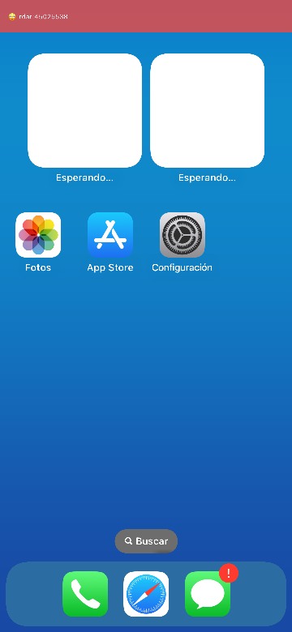
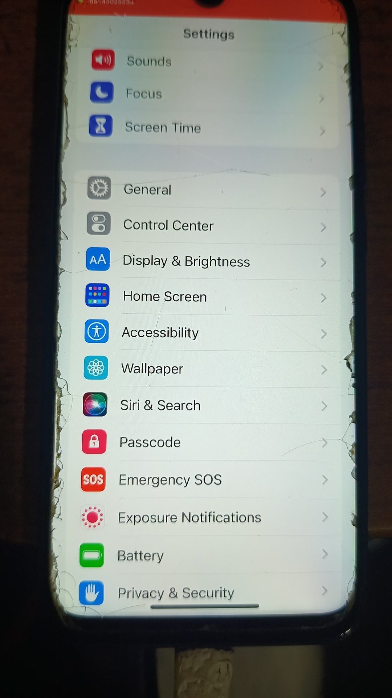
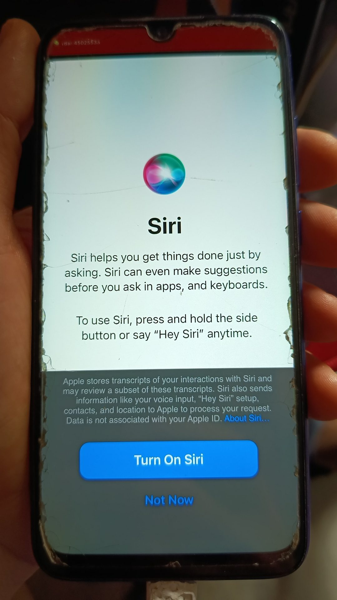
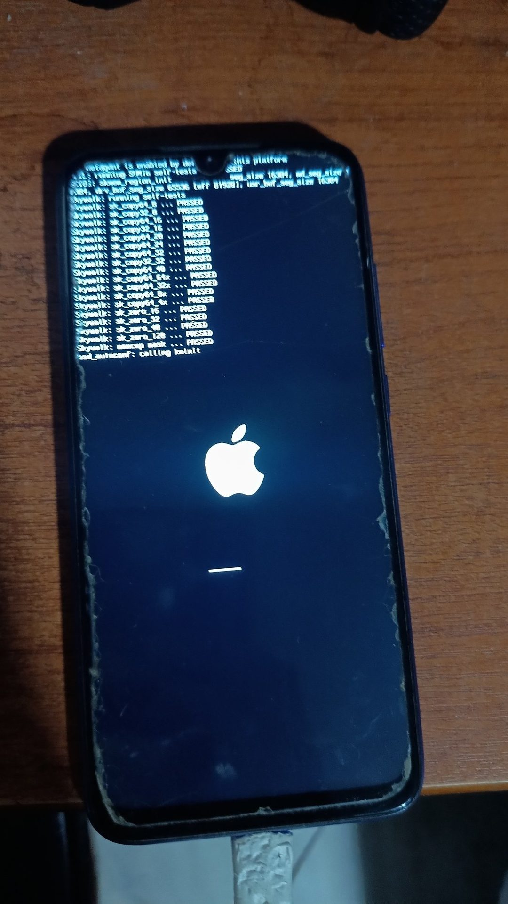

# iOS 16 on the Redmi Note 7 (lavender)

A non-commercial research port of **XNU 8796** (Darwin 22 / iOS 16) and the **iPhone X (D22AP) iOS 16.7.16 userland** to the **Redmi Note 7** (`lavender`, Qualcomm SDM660 / Snapdragon 660).



> **Status: boots to the iOS 16.7.16 lock screen and home screen in ~2–3 minutes.** This is an experimental bring-up, not a daily driver. The home screen renders icons, the dock and badges, Settings opens and the first-run Siri screen appears; touch (taps and swipes), physical buttons, USB networking (CDC-NCM: ping, SSH and a live kernel log from Windows) and fast eMMC reads (ADMA2) work on the device. The GPU, Wi-Fi, Bluetooth, audio, camera and a real battery gauge do not: rendering is done in software on the CPU. No Apple binaries are distributed in this repository.

The port is built on top of [`aLpHa-Git-69/ios-lavender`](https://github.com/aLpHa-Git-69/ios-lavender) (branch `lavender`), itself derived from [`dipa-studio/ios-sweet`](https://github.com/dipa-studio/ios-sweet). This repository documents the lavender-specific bring-up, the patches that made eMMC writes reliable, and the current state of the device.

## Progress

| Home screen | Settings | Siri setup |
| --- | --- | --- |
|  |  |  |
| SpringBoard's grid: app icons, dock, notification badge and the App Library pill. The two widget slots are still on `Esperando…`, waiting for their first timeline. | The whole Settings list renders and scrolls. | The first-run Siri screen appears. Without a microphone or speaker, Siri itself cannot work. |



Under the Apple logo and progress bar, the userland **Skylight** window server runs its software blit self-tests: `sk_copy64_8` through `sk_copy64_64x`, `sk_copy32_*`, `sk_zero_16` to `sk_zero_128` and a `memcmp` test all print `PASSED`. That is the software path that draws every frame on this port.

## What works

| Area | Status | Evidence / notes |
| --- | --- | --- |
| XNU boot | **Works** | `xnu-8796`, `kernel.development.lavender`, Mach-O arm64 |
| CPU bring-up | **Works** | 4× Cortex-A73 Gold, 16 KiB pages; Silver A53 cores parked (they do not support 16 KiB) |
| GICv3 / timers | **Works** | GIC 0x17a00000/0x17b00000, virtual/physical timers |
| eMMC (SDCC v5) | **Works** | Enumeration, HFSX root, journal replay, reads and writes; log ring flushes |
| HFSX root in `userdata` | **Works** | `rd=emmcroot0`, read-write; no Android dual boot |
| Framebuffer / AppleCLCD | **Works** | 1080×2340, stride 4320, software composition via IOSurface |
| `launchd` / daemons | **Works** | `launchd`, `backboardd`, `SpringBoard`, `securityd`, `keybagd`, `usermanagerd`, etc. |
| iOS GUI | **Works** | Apple logo, progress bar and the iOS 16 lock screen |
| Home screen | **Works** | SpringBoard grid with app icons, the dock, a notification badge and the App Library pill (`docs/images/home-screen.png`); the two widget slots stay on `Esperando…` (see the widgets row below) |
| Settings | **Works** | The whole Settings list renders and scrolls (`docs/images/settings.jpg`) |
| Siri setup | **UI only** | The first-run Siri screen appears (`docs/images/siri-setup.jpg`); without a microphone or speaker Siri cannot answer |
| Skylight self-tests | **Pass** | The boot console prints the window server's software blit self-tests as `PASSED` (`docs/images/boot-self-tests.jpg`) |
| Code signing bring-up | **Works** | `cs_enforcement_disable=1`, `unentitled_ios_sim_launch=1`, `launchd_unsecure_cache=1` |
| Persistent kernel log | **Works** | 4 MiB `SANTONILOG1` ring on the SYSTEM partition |
| 4 Gold cores | **Works** | `cpus=4`; `SWEET CPU: requested=4 selected=4` |
| Panel orientation | **Works** | The lock screen and the home screen are portrait and upright, filling the 1080×2340 panel (`docs/images/lock-screen.jpg`, `docs/images/home-screen.png`) |
| Physical buttons | **Works** | Patch `0201`: Power/Volume Up/Volume Down through the SDM660 SPMI arbiter v3, delivered to iOS HID |
| USB network | **Works** | Patches `0200`, `0210`–`0213`: DWC3 + QUSB2 bring-up, CDC-NCM (Windows UsbNcm, macOS, Linux), `ping 192.168.7.2`, live kernel log on UDP 5140 (`sweetusb=2`; `tools/usbnet-windows.ps1`). Root SSH over the link (dropbear, `docs/SSH.md`) |
| Touch | **Works** | Novatek NT36672A on QUP1 I2C (bit-banged): patches `0193`–`0208`, `0230`, `0231`, `0234`. Taps, icons and the swipe-up unlock work; ~249 frames per 10 s with 0 I2C errors (~14 ms per read). `0234` makes SweetHID use the real 1080×2340 panel (it assumed 2400, which shifted touches and hid the bottom edge). Kernel must be built by the CI (Xcode 15): a local Xcode 16.2 build read garbage firmware info and left touch disabled |
| eMMC reads by ADMA2 | **Works** | Patches `0232`, `0233`: the SDCC v5 core has no SDMA, only ADMA2. Cold reads ~465 KB/s → ~16 MB/s, boot to the lock screen ~23 min → ~2–3 min. Writes stay PIO |
| Wallpaper: Color | **Works (preview)** | The wallpaper gallery opens and shows a preview for Color (see Wallpapers below) |

## What does not work yet

| Area | Status | Notes |
| --- | --- | --- |
| GPU acceleration | **Missing** | Adreno 512 has no driver and there is no Metal device (`MTLCreateSystemDefaultDevice()` returns nil). An empty `IOAcceleratorES` keeps QuartzCore from waiting; everything is drawn by CoreAnimation's software renderer (`CA::OGL::SW`), see Performance |
| Camera | **Missing** | Camera button and camera stack are not implemented |
| Wi-Fi | **Missing** | No Wi-Fi driver or firmware for the WCN3990 radio; the network is USB only |
| Bluetooth | **Missing** | No Bluetooth transport; `bluetoothd` respawns in a loop without hardware |
| Audio | **Missing** | The phone uses the PM660L analog codec, the LPASS digital codec/SoundWire and the ADSP (not the WCD9335; the DTBO disables `slim_aud`). Patch `0500` is a read-only platform probe (`lavaud=1`): the ladder to sound is in [docs/AUDIO.md](docs/AUDIO.md). |
| Wallpapers (most) | **Partial** | Only simple wallpapers (Color) render a preview; ones that need Metal such as Astronomy are very slow or fail. See Wallpapers |
| Battery / charging UI | **Partial** | Static battery fallback (`100%`, 4200 mV); no gauge driver |
| Home screen widgets | **Missing** | Both slots keep the `Esperando…` placeholder: the WidgetKit extension never hands over a first timeline. Not investigated yet; it sits in the same extension-hosting area as the wallpaper providers |
| Screen colours | **To verify** | The date, clock and status bar render red/orange on the lock screen and home screen: wallpaper tint or a framebuffer colour-format issue, not checked yet |
| RTC / date | **Partial** | Patch `0220` reads the PM660 RTC. Its raw count is not Unix time (Android keeps its own offset), so each phone needs `sweetrtcoff=` measured once in TWRP (`docs/BOOT.md`); the home-screen clock still reads `mié 4 feb 05:28` instead of the real date, so this unit's offset is still to be set |
| `preboot` / data volume | **Partial** | `libignition` cannot find the preboot volume; the boot continues unsealed |
| Second boot / boot time | **Works** | The second boot runs without the data migration and reaches the lock screen in ~2–3 min since the ADMA2 read path (`0233`); it was ~18–23 min with PIO reads |

## Performance

Everything on screen is drawn by the CPU: QuartzCore falls back to its software OpenGL renderer (`CA::OGL::SW`) because there is no GPU. Measured on the device (4× Cortex-A73, panel 1080×2340):

| Metric | Value | How |
| --- | --- | --- |
| Frames presented | median **~13 fps** over a boot, peaks of **30–34 fps** while animating | `SWEET FB: swap` lines in the live log, counted per second (patch `0215`) |
| Panel refresh | **30 Hz** | `sweetfb_hz=30`; the framebuffer copies at most one frame every other 60 Hz vsync |
| `backboardd` CPU | **~150–170 %** (of 400 %) on the idle lock screen | `ps` cumulative CPU time over 60 s windows; sampled with `spindump` |
| Where the time goes | `CA::OGL::SW::scan_convert`, `image_sampler`, `tex_color_matrix_4x4_bias`, `tex_multiply_color`, `fill_round_rect` | `spindump` of `backboardd`, symbolised against the 20H392 dyld shared cache |
| eMMC read | **~16 MB/s** (was ~465 KB/s) | ADMA2 read path, `0233` |
| Touch | **~25 frames/s** read from the controller, 0 I2C errors | `WHYRED TOUCH: 10s frames` log line |
| Boot to lock screen | **~2–3 min** (was ~23 min) | live log timestamps |

What was tried to lower the compositor load, and what it did:

- Notifying the vsync to CoreAnimation at the panel rate instead of a fixed 60 Hz (`0235`): the idle lock-screen CPU stayed at ~150–170 %; not a measurable gain at idle, it only caps animations at 30 fps.
- *Reduce Transparency* and *Reduce Motion* in Settings: no change in idle CPU (still ~149 %).
- Freezing PosterBoard (the wallpaper process): no change, so the wallpaper is not what keeps the compositor busy. The idle lock screen still presents 7–16 frames per second; the process that drives them is not identified yet.

A real fix needs a GPU path (a kernel driver for the Adreno 512 plus a Metal-compatible layer, which does not exist for iOS) or a much cheaper software compositing path. Neither is started.

## Wallpapers

Opening *Settings → Wallpaper → Add New Wallpaper* used to show a blank gallery and abort PosterBoard. Findings:

- `lsd` could not load `/System/Library/xpc/extensions.plist` (AMFI is missing), so PlugInKit saw no extensions. The precompiled catalog was set aside so iOS scans natively, the LaunchServices databases were rebuilt once, and an extension-point definition for `com.apple.posterkit.provider` was added. `GradientPosterExtension` and `CollectionsPoster` now register and start.
- PosterBoard then aborted in `-[PBFHomeScreenPreviewImageBuilder _imageForView:]`: it renders the preview with Metal (`MTLCreateSystemDefaultDevice()` → `newCommandQueue`) and put a nil queue into an `NSDictionary`. A small replacement for that method (`tools/posterboard-preview.m`) avoids the crash.
- Result: the gallery opens and **Color shows a preview**. Applying it to the home and lock screens is still to be verified.
- **Astronomy** and other wallpapers that link Metal still fail: `AegirPoster` and `CollectionsPoster` are terminated with `extension check-in timeout` and the system gets very slow. This needs a Metal device, so it is the same limit as the GPU.

## Milestones

- **2026-11-21 — Home screen, Settings and Siri setup on screen.** A device screenshot shows SpringBoard's home screen with app icons, the dock, a notification badge and the App Library pill; the two widget slots wait on `Esperando…`. Settings opens with its full list and the first-run Siri screen appears. The boot console shows Skylight's software blit self-tests passing before the lock screen. Evidence: `docs/images/home-screen.png`, `settings.jpg`, `siri-setup.jpg`, `boot-self-tests.jpg`.
- **2026-11-19 — Phase 0 safety net.** Verified stock fastboot ROM, TWRP, 15 partition backups + GPT, and a complete restore path.
- **2026-11-19 — First XNU boot.** Kernel built for `LAVENDER` in GitHub Actions; the first boot reached `launchd` but died with `CS_KILLED`.
- **2026-11-19 — Code-signing bring-up.** The CS/RW boot arguments let `launchd`, `xpcproxy`, `cfprefsd`, `powerd`, `distnoted`, `watchdogd` and `SpringBoard` run.
- **2026-11-19 — eMMC writes fixed.** Patch `0192` waits for DAT0 + `TRAN`/`READY_FOR_DATA` (CMD13) after every PIO write. Before it, CMD24/CMD25 timed out and the log ring stayed empty; after it, the ring flushed 100+ KiB with zero write timeouts.
- **2026-11-21 — eMMC reads by ADMA2.** The SDCC v5 core has no SDMA, only ADMA2. Patch `0233` moves reads to ADMA2 (PIO fallback, writes stay PIO): cold reads go from ~465 KB/s to ~16 MB/s and the boot to the lock screen from ~23 min to ~2 min.
- **2026-11-21 — Touch fixed for good.** Local kernel builds read garbage firmware info from the Novatek (`nvt fwinfo invalid`) and left touch disabled; kernels from the CI (Xcode 15) do not. `0234` makes SweetHID use the real 1080×2340 panel, so the swipe from the bottom edge now unlocks and icon taps land where they should.
- **2026-11-21 — Wallpaper gallery opens.** Extension points and providers registered, the Metal-less preview crash worked around: Color shows a preview. Astronomy is still slow.
- **2026-11-21 — Compositor profile.** `spindump` shows the CPU going into CoreAnimation's software renderer; `0235` aligns the vsync notification with the panel rate. No idle gain.
- **2026-11-19 — Four Gold cores.** `cpus=4` brings up all four A73 cores; the A53 Silver cores stay parked because they cannot run 16 KiB pages.
- **2026-11-19 — First-boot data migration.** A fresh root image needs one long `DataMigration` pass. The image now carries `com.apple.DataMigration.plist` with `LastSystemVersion = 20H392`, so subsequent boots should skip it.
- **2026-11-19 — iOS 16 lock screen.** The device reached the iOS 16.7.16 lock screen: `Wednesday, December 31`, `4:37`, the camera shortcut and the home indicator are visible. This is the current state.
- **2026-11-20 — USB and button drivers (host-tested).** `sweet_usb.c` and `sweet_keys.c` were compiled for lavender but never called (their only caller is the UFS path), and they used other SoCs' addresses. Patches `0200`/`0201` port them to SDM660 with addresses from the phone's DTB and start them on lavender. On the device the keys worked at once; USB needed three more fixes found with ~1-minute `sweetusbhold` boots: `0210` powers the QUSB2 PHY ABL leaves off, `0211` brings the DWC3 core up as Linux does, `0212` releases the PHY's UTMI test mux.
- **2026-11-20 — Touch works: iOS home screen reached by touch.** The Novatek driver had been reading the controller in slow motion: on this port `delay()` never spins (the CPUs are registered with `powergate_latency` 0, so XNU blocks for every delay), and the bit-banged I2C does ~1800 delays per frame. `0230` times the bit-bang with a busy-wait: 0 I2C errors, frames in ~14 ms instead of seconds, and the setup screens, home screen and app icons respond to taps.
- **2026-11-20 — 30 s off every boot.** Every boot stopped for exactly 30.000 s while XNU waited for an `IORTC` resource nothing publishes; that wait is also why the calendar started at 1970. `0220` skips it (as XNU does for BCM2837) and reads the PM660 RTC: eMMC and USB now come up at ~16 s instead of ~46 s.
- **2026-11-20 — USB network on Windows.** `0213` turns the gadget into CDC-NCM: Windows 11 binds its in-box UsbNcm driver, `ping 192.168.7.2` answers (70/70, 1400-byte frames) and the kernel console streams live to the PC. No more TWRP round-trips to read a log.

## Hardware

| | Redmi Note 7 (`lavender`) |
| --- | --- |
| SoC | Qualcomm SDM660 / Snapdragon 660 |
| CPU | 4× Cortex-A73 Gold + 4× Cortex-A53 Silver |
| Page size | 16 KiB on Gold only; Silver parked |
| RAM / storage | 4 GB / 64 GB eMMC 5.1 |
| eMMC controller | Qualcomm SDCC v5 at `0x0c0c4000`, GIC SPI 110 |
| Display | 1080×2340, stride 4320, framebuffer `0x9d400000` |
| Touch | Novatek NT36672 (QUP1 I2C, `0x62`); Synaptics is the alternative panel |
| PMIC | PM660 / PM660L |
| GPU | Adreno 512 (no iOS driver) |
| Bootloader | Unlocked Xiaomi ABL; `fastboot boot` is stubbed on this unit |

See [`docs/HARDWARE.md`](docs/HARDWARE.md) for the full audit and constraints.

## How it boots

```
Xiaomi ABL
  -> shim in the recovery partition (Power + Volume Up)
  -> XNU kernel + ADT + boot arguments
  -> HFSX root from userdata (rd=emmcroot0)
  -> launchd -> mount-phase-1/2 -> backboardd -> SpringBoard
  -> iOS 16 lock screen
```

The shim is flashed to `recovery`; `fastboot boot` is stubbed by this ABL. `fastboot reboot recovery` boots Android and MIUI restores the stock recovery, so the working sequence is: flash the shim, power off, then **Power + Volume Up**.

The current boot arguments include:

```
rd=emmcroot0 emmcrw=1 rootrw=1
cs_enforcement_disable=1 unentitled_ios_sim_launch=1 launchd_unsecure_cache=1
sweetlog=1 sweetfb_noconsole=1 sweetfb_stayon=1 sweetfb_hz=30
wdt=-1 wdt_test=no_user_checkin cpus=4
```

See [`docs/BOOT.md`](docs/BOOT.md) for the full chain and the log-pull procedure.

## Build

The repository does not contain Apple binaries, the IPSW, the 16 GiB root image or the stock ROM. You need to provide those yourself.

1. **Kernel**: push a change to `xnu/patches/` (or run the workflow manually) and `.github/workflows/xnu.yml` builds `kernel.development.lavender` on `macos-15`.
2. **Shim**: `tools/build-shim.sh <kernel>` packs the kernel, ADT and boot arguments into an Android boot image.
3. **Root image** — extract `OS.dmg`, `SystemOS.dmg` and `AppOS.dmg` from the iPhone X 16.7.16 IPSW and build the HFSX image with `bergamota/tools/mkiosroot-macos.sh` plus `sweet-root-tweaks.py`.
4. **Flash** — `fastboot -S 512M flash userdata ios16-root.simg`, then `fastboot flash recovery shim-boot.img`, then Power + Volume Up.

The exact commands, hashes and caveats are in [`docs/BUILD.md`](docs/BUILD.md).

## Repository layout

```
README.md                 this file
README.es.md              Spanish summary
docs/                     hardware, build, boot, audio, achievements, roadmap, legal
  images/                 lock screen, home screen, Settings, Siri setup and boot self-tests
xnu/patches/              the complete XNU patch series (0001-0192 base, 0200+ lavender)
shim/                     the boot shim (Android boot image -> XNU)
resources/lavender_dtb.bin the board DTB the ABL accepts
drivers/                  generated mirrors of the main drivers (read-only views of the patches)
tools/                    shim/ADT/payload builders, log pull/decoder, root and DataMigration helpers
tests/                    patch checks and host tests; tests/host/ runs the USB/keys drivers on simulated registers
.github/workflows/xnu.yml kernel CI
```

The repository holds everything needed to build the lavender kernel and shim. Apple's XNU source comes from Apple's open-source release at build time. Apple binaries (IPSW, ADT, root image) are never included.

The audio bring-up (the PM660L/LPASS/ADSP chain, patches `0500`+) and its current status are in [`docs/AUDIO.md`](docs/AUDIO.md).

## Companion repository: lavender-metal

The GPU work lives in its own repository, [pcorezzola/lavender-metal](https://github.com/pcorezzola/lavender-metal): 
the Adreno 512 (A5xx) bring-up notes, the host-side register layer and PM4 builder with a fake command processor, and the 
plan towards a Metal-compatible layer. The kernel driver itself is shipped here, as patches `0236`-`0243`, `0249`-`0253` 
and `0300`+ in `xnu/patches/` (source mirror in `drivers/gpu/lavender_gpu.c`), and is enabled with the `lavgpu=N` boot-arg. 
GPU patches use the number range 0300-0399.

## Credits

- [`aLpHa-Git-69/ios-lavender`](https://github.com/aLpHa-Git-69/ios-lavender) — the lavender/whyred XNU tree, eMMC driver, shim and notes. This port would not exist without it.
- [`dipa-studio/ios-sweet`](https://github.com/dipa-studio/ios-sweet) — upstream tooling and bring-up methodology.
- [`ry-diffusion/bergamota`](https://github.com/ry-diffusion/bergamota) — `mkiosroot-macos.sh`, shim ideas and the Poco F1 port.
- [`MakrSas/ios-topaz`](https://github.com/MakrSas/ios-topaz) — reference for the A73/A53 topology, Wi-Fi and GPU work.
- [`oosexgang/hakios-xnu-kernel`](https://github.com/oosexgang/hakios-xnu-kernel) — methodology reference for XNU-on-Android.
- Apple's open-source XNU (`xnu-8796`) and the iOS 16.7.16 userland, which are **not** redistributed here.

## Legal

This is a research project. XNU is open source under the Apple Public Source License; the iOS userland, IPSW, device trees and other Apple binaries are **not** distributed in this repository. Downloading and using Apple firmware may be subject to Apple's EULA and local law. Do not use this project with personal data, an Apple ID, or as a daily driver. See [`docs/LEGAL.md`](docs/LEGAL.md).

## Contributing

The most useful next steps are faster touch (hardware QUP I2C instead of bit-bang), the boot time (~18 min to the lock screen) and the system-wide `delay()` issue (CPU `powergate_latency` 0). If you have a lavender unit and can test, open an issue with the boot log and the exact panel/touch variant.
